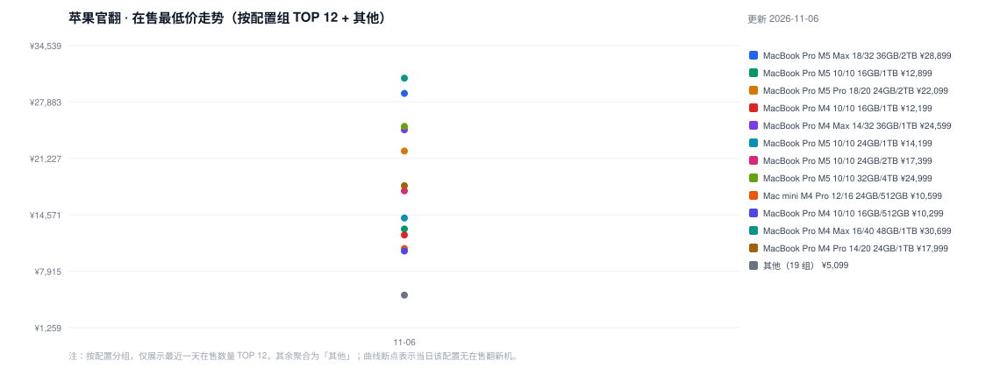
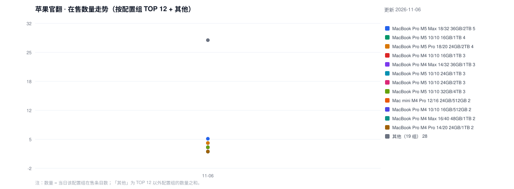

# 苹果中国官翻库存追踪（Mac Studio / Mac mini / MacBook Pro）

每日 **19:00** 自动抓取 [苹果中国官方翻新商店](https://www.apple.com.cn/shop/refurbished/mac) 的在售机型与价格，记录成时间序列。

- 数据：<code>data/YYYY-MM-DD.json</code>（每日快照）、<code>history.csv</code>（汇总）
- 生成物：<code>chart_price.svg</code> / <code>chart_stock.svg</code>（GitHub 内嵌渲染）、<code>index.html</code>

## 图表怎么看

- 图表**按配置分组**：配置 = 产品线 + 芯片 + CPU/GPU 核数 + 内存 + 硬盘（如 <code>MacBook Pro M5 Pro 18/20 24GB/2TB</code>），不同颜色各一条折线。
- 为避免图例爆炸，只画**最近一天在售数量 TOP 12** 的配置组，其余配置聚合为一条灰色的「其他」线（价格取最低、数量求和）。TOP 12 每天可能轮换。
- <code>chart_price.svg</code> = 各配置组当日在售最低价；<code>chart_stock.svg</code> = 各配置组当日在售条目数。曲线断点表示当日该配置无在售翻新机。

## 价格走势（在售最低价）

## 在售数量

## 最新在售清单

见 [latest.md](latest.md)（更新于 2026-11-06）。

## 说明

- 官翻价为苹果官方定价，通常不变；波动主要来自**在售配置更替与补货/售罄**，因此同时记录价格与在售数量。
- 清单按 产品线 → 芯片 → CPU/GPU → 内存 → 硬盘 → 价格 排序，同配置相邻。
- 抓取：Tabbit Browser CLI 渲染页面 → 解析商品卡（价格格式 `RMB 15,599`）。
- 抓取脚本 <code>scripts/scrape.py</code>，渲染脚本 <code>scripts/render.py</code>；纯本地运行，无第三方依赖。
